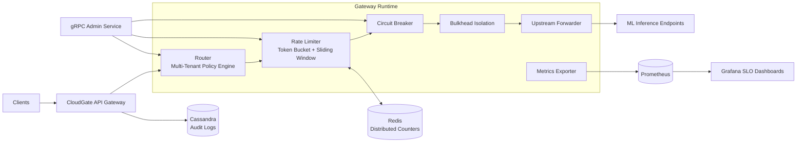
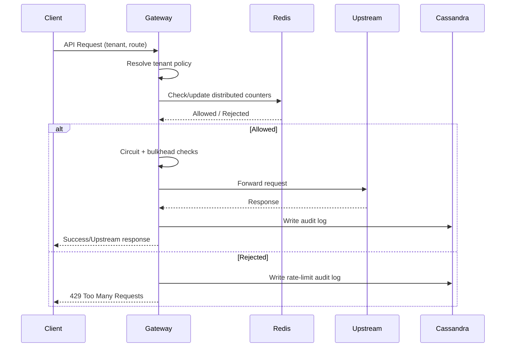

# ☁️ CloudGate — Distributed API Gateway & Rate Limiter

<p align="center">
  <strong>High-throughput, multi-tenant API gateway built for reliability, fairness, and real-time control.</strong>
</p>

<p align="center">
  
  
  
  
  
  
</p>

---

## 🚀 Overview

**CloudGate** is a distributed API Gateway and Rate Limiter engineered to protect downstream ML inference services at scale.

It combines:
- **10k+ req/sec throughput** in Go using goroutines and non-blocking I/O
- **Token Bucket + Sliding Window** rate limiting with **Redis-backed distributed counters**
- **Multi-tenant routing** with per-tenant policy enforcement
- **Reliability controls** via circuit breaker and bulkhead isolation
- **Low-latency audit persistence** in Cassandra (sub-10ms @ 5k writes/sec)
- **Production deployment** on Kubernetes/EKS with Helm + HPA
- **20+ Prometheus metrics** and Grafana SLO dashboards targeting **p99 < 50ms**
- **gRPC admin service** for real-time policy updates

---

## ✨ Core Capabilities

### 1) Distributed Rate Limiting
- **Token Bucket** for burst handling
- **Sliding Window** for smoother sustained control
- Redis atomic operations for globally consistent tenant-level limits

### 2) Multi-Tenant Traffic Governance
- Route resolution by tenant + endpoint policy
- Per-tenant quotas, concurrency limits, and enforcement hooks
- Isolated controls so noisy tenants do not impact others

### 3) Resilience Patterns
- **Circuit Breaker** to avoid cascading failure during downstream degradation
- **Bulkhead Isolation** to partition resources and protect critical flows
- Adaptive fallback behavior for graceful degradation

### 4) Observability & SLOs
- Request lifecycle metrics, limiter metrics, breaker state metrics
- Saturation and latency telemetry exported to Prometheus
- Grafana dashboards for golden signals and SLO tracking

### 5) Real-Time Operations
- gRPC admin API to push policy changes without downtime
- Runtime policy updates for incident response and rapid tuning

---

## 🧠 High-Level Architecture



---

## 🔁 Request Lifecycle



---

## 📊 Performance Profile

| Metric | Target / Achieved |
|---|---|
| Throughput | 10k+ requests/sec |
| Audit log writes | 5k writes/sec |
| Cassandra write latency | < 10 ms |
| End-to-end latency (p99) | < 50 ms |
| Exported metrics | 20+ |

---

## 🧩 Tech Stack

- **Language:** Go
- **Rate Limit Store:** Redis
- **Audit Storage:** Cassandra
- **Orchestration:** Kubernetes (EKS), Helm, HPA
- **Observability:** Prometheus, Grafana
- **Control Plane:** gRPC

---

## 📐 Suggested Repository Structure

> This repository currently contains project metadata. The structure below reflects the intended CloudGate layout.

```text
.
├── cmd/
│   ├── gateway/
│   └── admin/
├── internal/
│   ├── router/
│   ├── ratelimit/
│   ├── resilience/
│   ├── observability/
│   └── storage/
├── api/
│   └── proto/
├── deploy/
│   ├── helm/
│   └── k8s/
├── dashboards/
└── README.md
```

---

## ⚙️ Deployment Model (Kubernetes/EKS)

- Horizontal pod autoscaling on CPU/RPS saturation
- Config-driven tenant policy rollout through gRPC admin plane
- Redis and Cassandra as external state services
- Prometheus scrape + Grafana dashboards for SLO governance

---

## 🛡️ Why CloudGate

CloudGate is designed for teams running high-value, latency-sensitive APIs (especially ML inference) where **fairness, resilience, and operability** are critical. It enables safe scale-out while preserving user experience and backend health.

---

## 🤝 Contributing

Contributions are welcome. If you add implementation code, include:
- clear module boundaries,
- load/latency benchmark evidence,
- and observability instrumentation for new paths.

---

## 📄 License

This repository is licensed under the [Apache License 2.0](./LICENSE).
